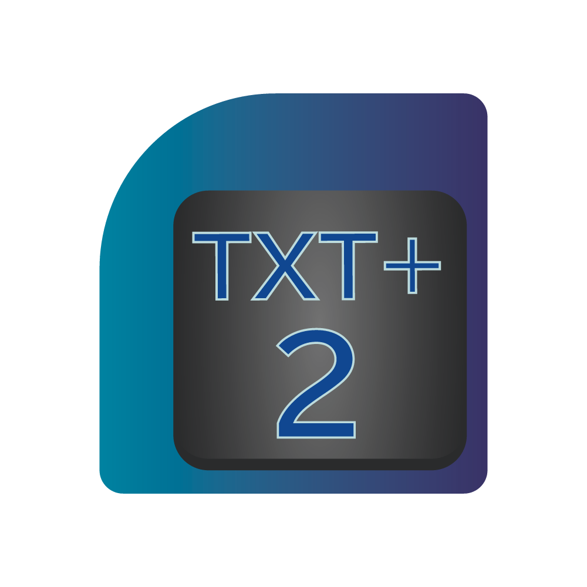
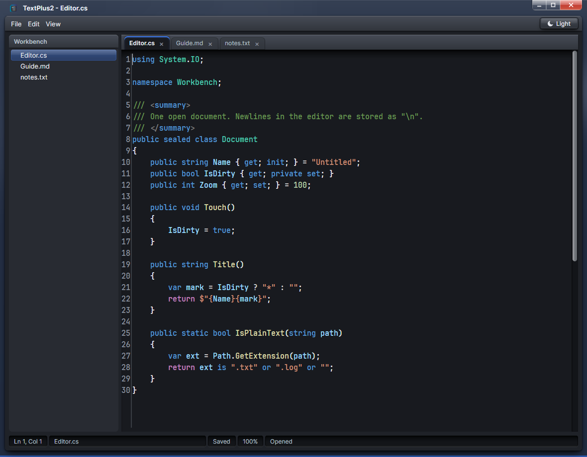
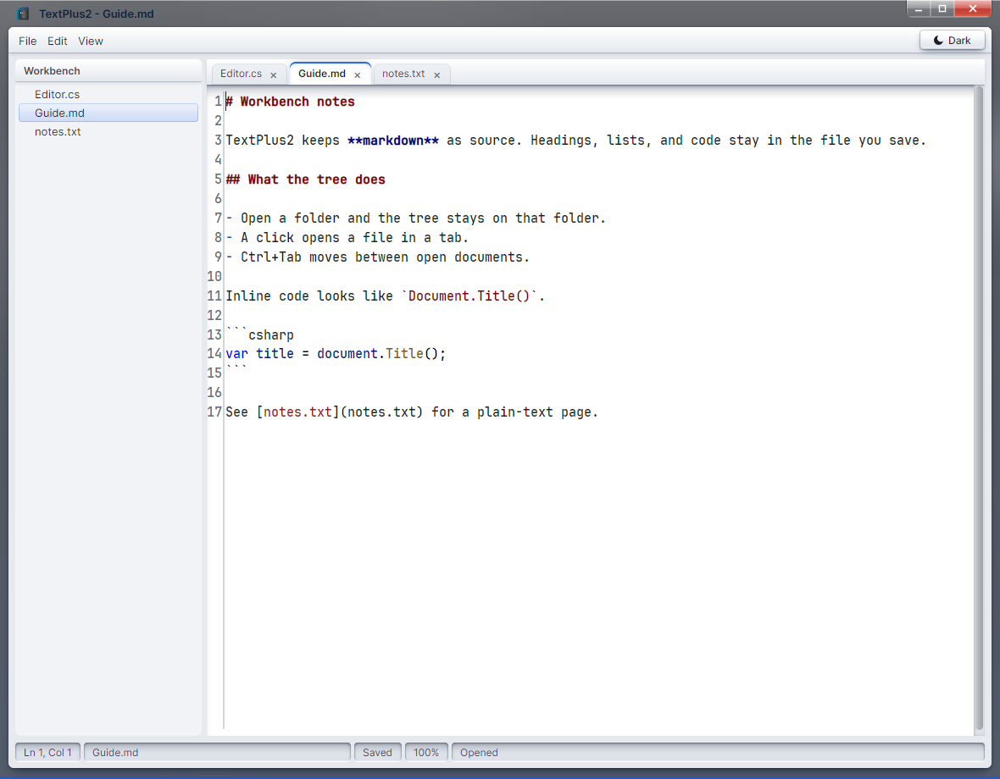
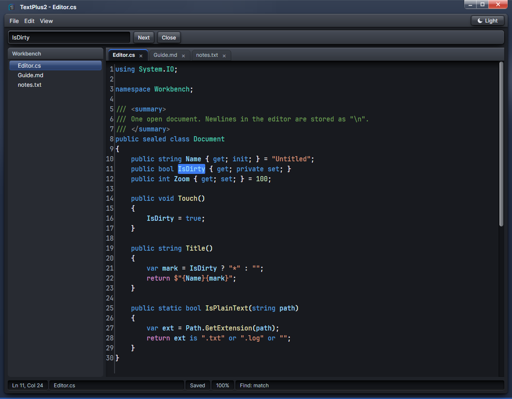
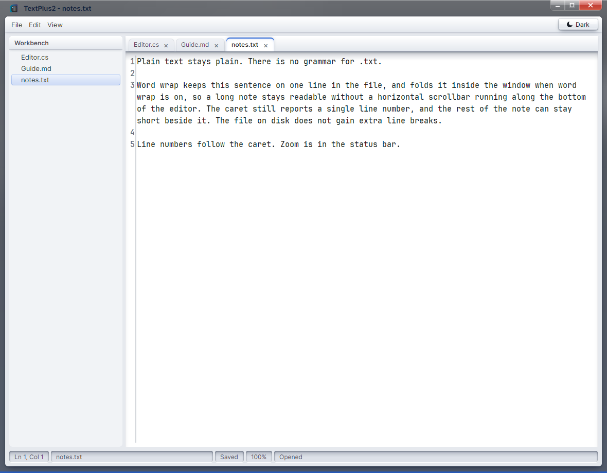

# TextPlus2

<p align="center">
  
</p>

A small text editor for Windows and Linux, and the successor to [TextPlus](https://github.com/Nan0MK/TextPlus).

TextPlus2 keeps several files open in tabs, colors source from the file extension, and shows a file tree beside the editor. The window follows the system theme at startup. Light and dark can be switched for the rest of the session.

<p align="center">
  
</p>

## Features

- Syntax highlighting chosen from the file extension. An unknown extension stays plain text.
- Markdown stays in the editor. The markdown grammar colors headings, code, and links in the source.
- Document tabs. Each tab keeps its own text, undo stack, and caret.
- A file tree. A click opens a file. Open Folder sets the root and leaves the current document alone.
- Find and Find Next.
- Line numbers, zoom from 50% to 300%, and word wrap.
- Light and dark themes, and the app icon in the title bar and on the Windows executable.

### Markdown



### Find



### Word wrap

A long line stays one line in the file. With word wrap on, line 3 folds inside the window and the line number stays 3. `notes.txt` has no grammar, so it stays plain.



## Shortcuts

| Action | Shortcut |
| --- | --- |
| New | Ctrl+N |
| Open | Ctrl+O |
| Save | Ctrl+S |
| Save As | Ctrl+Shift+S |
| Close tab | Ctrl+W |
| Switch tab | Ctrl+Tab, Ctrl+Shift+Tab |
| Find | Ctrl+F |
| Find Next | F3 |
| File tree | Ctrl+B |
| Zoom | Ctrl+Plus, Ctrl+Minus, Ctrl+0, Ctrl+scroll |

Undo, redo, cut, copy, paste, and select all use the usual editor shortcuts.

## Run

The current version is **26_1.0.0**. The app targets .NET 10. From the repo root:

```powershell
dotnet run --project csharp
```

`run-csharp.ps1` does the same thing and forwards arguments.

```powershell
dotnet run --project csharp -- path\to\file.txt
dotnet run --project csharp -- path\to\folder
```

`build-release.ps1` writes self-contained Windows and Linux builds to `releases/`. That folder stays on your machine. The Windows executable is over GitHub's 100 MiB file limit, so the builds are not in this repository. On Linux, mark the binary executable if the file system did not: `chmod +x TextPlus2`.

Pass a file to open it, or a folder to root the file tree there.

The interface is [ChiselUI](chiselui-avalonia/README.md). The editor is AvaloniaEdit with TextMate grammars, and the editor face is JetBrains Mono SemiBold.

## This release leaves out

Replace, language servers, and a rendered markdown preview. Theme, zoom, the file tree, follow-open-file, and word wrap last for the session only.
